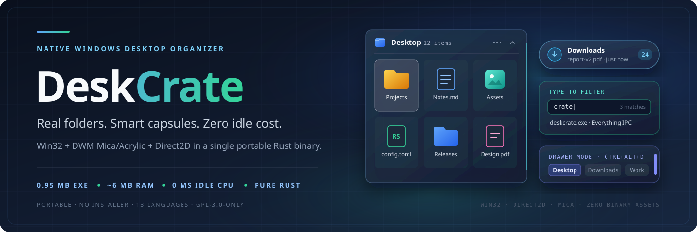
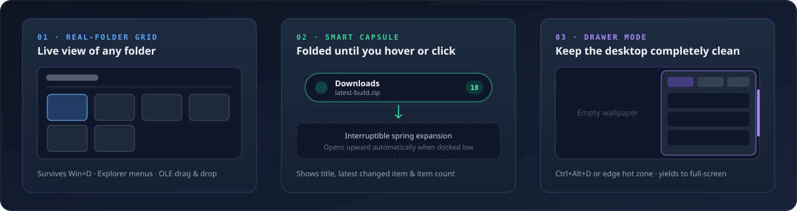

<!-- project:start -->
# DeskCrate

A lean, native Windows desktop organizer written in pure Rust. Grids on your desktop are live views of real folders. They can fold into smart capsules, or move into a drawer so the desktop stays empty.

**[Download v0.1.0](https://github.com/seiya058904/DeskCrate/releases/latest)** · [Source](https://github.com/seiya058904/DeskCrate)
<!-- project:end -->

<p align="center">
  <a href="https://github.com/seiya058904/DeskCrate/releases/latest">
    
  </a>
</p>

<div align="center">

<h2>🗂️ A Tidy Desktop That Costs Almost Nothing</h2>

<p><strong>One 0.95 MB exe. About 6 MB of memory. 0 ms of CPU while idle.</strong></p>

<p>Grids that show real folders and fold into capsules on hover,<br>
with spring-driven motion you can interrupt at any point, the real Explorer menus, and drag and drop.</p>

<p>
  <a href="https://github.com/seiya058904/DeskCrate/releases/latest"></a>
  
  
  
  <a href="LICENSE"></a>
</p>

<p>
  <a href="https://github.com/seiya058904/DeskCrate/releases/latest"><strong>⬇ Download for Windows</strong></a>
  &nbsp;·&nbsp;
  <a href="#three-modes">🪟 Three Modes</a>
  &nbsp;·&nbsp;
  <a href="#highlights">✨ Highlights</a>
  &nbsp;·&nbsp;
  <a href="#footprint">📏 Footprint</a>
  &nbsp;·&nbsp;
  <a href="#download">📦 Get Started</a>
  &nbsp;·&nbsp;
  <a href="#usage">🖱️ Usage</a>
  &nbsp;·&nbsp;
  <a href="#how-it-works">🛠️ How It Works</a>
</p>

<p><sub>PURE RUST &nbsp;·&nbsp; WIN32 + DWM MICA / ACRYLIC &nbsp;·&nbsp; DIRECT2D &nbsp;·&nbsp; 13 LANGUAGES &nbsp;·&nbsp; PORTABLE &nbsp;·&nbsp; NO RUNTIME</sub></p>

</div>

---

> **No installer. No runtime. No background services.**
>
> Download one `.exe` and run it. A commented `config.toml` appears next to it, and your changes apply as soon as you save. The only registry write is the optional autostart entry.

> [!NOTE]
> DeskCrate is an unofficial, independent Rust re-implementation of [DeskBox](https://github.com/Tianyu199509/DeskBox) (GPL-3.0-only). It follows DeskBox's file-organizing experience and visual language. It is not affiliated with or endorsed by the DeskBox author, uses none of DeskBox's names, logos or icons, and never contacts DeskBox services.

<a id="three-modes"></a>
## 🪟 Three Ways to Keep Your Desktop Clear

Keep your active folders pinned right on the wallpaper, fold them into sleek capsules until your cursor arrives, or tuck every grid into a single screen-edge drawer.

<p align="center">
  
  <br>
  <sub>ORIGINAL VECTOR DIAGRAM · DESKCRATE RENDERS NATIVE WIN32 + DWM MICA/ACRYLIC WINDOWS AT RUNTIME</sub>
</p>

<a id="highlights"></a>
## ✨ Highlights

<table>
  <tr>
    <td width="50%" valign="top">
      <h3>📁 Real Folders</h3>
      <p><sub>LIVE DIRECTORY VIEW · SURVIVES WIN+D</sub></p>
      <p>Each grid is a live view of an existing directory. Uninstalling DeskCrate or deleting its config never touches your files. Grids survive <code>Win+D</code> and re-attach automatically after Explorer restarts.</p>
    </td>
    <td width="50%" valign="top">
      <h3>💊 Smart Capsules</h3>
      <p><sub>HOVER OR CLICK · CONTEXT-AWARE EXPANSION</sub></p>
      <p>A grid can stay open, expand on click, or expand on hover and fold when you leave. Each capsule shows the title, the most recently changed item and the item count. Capsules docked low on the screen open upward.</p>
    </td>
  </tr>
  <tr>
    <td width="50%" valign="top">
      <h3>🌊 Fluid, Interruptible Motion</h3>
      <p><sub>DISPLAY-SYNCED SPRINGS · ZERO STUTTER</sub></p>
      <p>Animation runs on a display-synced frame clock. Springs drive folding and the drawer, keeping their velocity when you reverse midway. Hover highlights fade, presses sink and spring back, the wheel glides, and snapped edges glow.</p>
    </td>
    <td width="50%" valign="top">
      <h3>🪟 Native Shell Integration</h3>
      <p><sub>EXPLORER MENUS · OLE DRAG &amp; DROP</sub></p>
      <p>Real Explorer icons and thumbnails, the real context menu (including Send to, Open with and third-party entries) and OLE drag and drop. Move, copy, conflict dialogs and undo all behave as they do in Explorer.</p>
    </td>
  </tr>
  <tr>
    <td width="50%" valign="top">
      <h3>🗄️ Drawer Mode</h3>
      <p><sub>EMPTY DESKTOP · HOTKEY OR EDGE HOT ZONE</sub></p>
      <p>Keep the desktop completely empty. A global hotkey or a thin hot zone at a screen edge slides in one drawer with a tab for each grid. The hot zone stays out of the way while full-screen apps run.</p>
    </td>
    <td width="50%" valign="top">
      <h3>⌨️ Desktop-Style Details</h3>
      <p><sub>RENAME · ZOOM · MARQUEE · SNAPPING</sub></p>
      <p>Name expansion, slow-click rename, arrow-key navigation, <code>Ctrl</code>+wheel icon zoom, path tooltips, auto-scrolling marquee selection, and glowing edge snapping — small Explorer details reproduced faithfully.</p>
    </td>
  </tr>
  <tr>
    <td width="50%" valign="top">
      <h3>🔎 Type to Filter</h3>
      <p><sub>LOCAL FILTER · OPTIONAL EVERYTHING IPC</sub></p>
      <p>Start typing in a focused grid or in the drawer to filter it immediately. When <a href="https://www.voidtools.com/">Everything</a> is running, results from the whole disk appear below the local matches. Nothing extra is bundled.</p>
    </td>
    <td width="50%" valign="top">
      <h3>📥 Minimal Auto Filing</h3>
      <p><sub>DRY-RUN DEFAULT · MOVE ONLY · UNDOABLE</sub></p>
      <p>Rules match on extension, keyword and idle days. Filing is off and dry-run by default. Files are only moved, never deleted or overwritten. Partial downloads are skipped, and every batch can be undone.</p>
    </td>
  </tr>
  <tr>
    <td width="50%" valign="top">
      <h3>🌐 13 Languages</h3>
      <p><sub>ZH-CN · ZH-TW · EN-US · JA-JP · KO-KR · DE · FR · ES · PT · RU · AR · HI · BN</sub></p>
      <p>Follows your Windows display language automatically, or set <code>[general] language</code> explicitly in <code>config.toml</code>.</p>
    </td>
    <td width="50%" valign="top">
      <h3>🎒 Portable, Zero Binary Assets</h3>
      <p><sub>ONE EXE · LIVE-RELOAD CONFIG.TOML</sub></p>
      <p>One <code>.exe</code> plus the <code>config.toml</code> next to it. The config reloads automatically and preserves your comments. Icons are drawn in code, so the repository contains no binary files.</p>
    </td>
  </tr>
</table>

<a id="footprint"></a>
## 📏 Footprint

<sub>Release build on Windows 11, measured with one grid of 53 items.</sub>

| Budget | Target | Measured |
| :--- | :--- | :--- |
| **Executable** (static CRT, icon included) | `< 5 MB` | **0.95 MB** |
| **Idle private memory** | `< 20 MB` | **~6 MB** (working set ~1 MB) |
| **Idle CPU** | `~0` | **0.0 ms over 20 s** |
| **Processes left after exit** | none | **single process, exits cleanly** |

To reproduce these numbers locally, run:

```powershell
pwsh scripts/check-budget.ps1 -Build -Launch
```

<a id="download"></a>
## 📦 Download & Quick Start

**[Get the latest release →](https://github.com/seiya058904/DeskCrate/releases/latest)**

| Current release · v0.1.0 | Download |
| :--- | :--- |
| **Windows x64 portable executable** | [deskcrate.exe](https://github.com/seiya058904/DeskCrate/releases/download/v0.1.0/deskcrate.exe) |
| **File integrity** | [SHA256SUMS.txt](https://github.com/seiya058904/DeskCrate/releases/download/v0.1.0/SHA256SUMS.txt) |

1. Download `deskcrate.exe` into any folder and launch it.
2. On first run, DeskCrate writes a commented `config.toml` next to the executable (or in `%LOCALAPPDATA%\DeskCrate` if the folder is not writable) with default *Desktop* and *Downloads* grids.
3. Edit `config.toml` whenever you want to customize materials, tint, corners, density, capsule timings, drawer edge, or filing rules — changes reload live on save.

<details>
<summary><strong>🛡️ Unsigned binary &amp; SHA-256 verification</strong></summary>

`deskcrate.exe` is **not code-signed**, so Windows SmartScreen may show a warning on first run. Download from the official release page and compare its hash against `SHA256SUMS.txt` before running:

```powershell
Get-FileHash .\deskcrate.exe -Algorithm SHA256
```

</details>

<a id="usage"></a>
## 🖱️ Usage & Shortcuts

| Where | Action |
| :--- | :--- |
| **Grid title** | Drag the title to move the grid, or drag its edges to resize. Grids snap to screen edges and to each other with a glowing edge indicator. Double-click the title to rename. |
| **Title buttons** | `⊕` adds a new grid. `…` opens the grid menu (rename, expand behaviour, lock position/size, open in Explorer, refresh, remove grid without touching files). `⌃` folds the grid. |
| **Items** | Select with a click, `Ctrl`, `Shift` or marquee. Double-click or press <kbd>Enter</kbd> to open. Slow-click a name to rename. Right-click for the real Explorer menu. Drag items in or out. `Ctrl`+wheel resizes icons. |
| **Keyboard** | Arrows, <kbd>Home</kbd>/<kbd>End</kbd>, <kbd>PgUp</kbd>/<kbd>PgDn</kbd> · <kbd>F2</kbd> rename · <kbd>Del</kbd> Recycle Bin · <kbd>Ctrl</kbd>+<kbd>C</kbd>/<kbd>X</kbd>/<kbd>V</kbd>/<kbd>A</kbd> · <kbd>F5</kbd> refresh · <kbd>Alt</kbd>+<kbd>Enter</kbd> properties · <kbd>Shift</kbd>+<kbd>F10</kbd> menu. Typing starts filtering; <kbd>Esc</kbd> clears it. |
| **Tray icon** | Left-click raises all grids until you click elsewhere; in drawer mode it toggles the drawer. Right-click opens the menu. |
| **Global hotkey** | <kbd>Ctrl</kbd> + <kbd>Alt</kbd> + <kbd>D</kbd> toggles the drawer in drawer mode, or raises all grids in desktop mode (configurable in `config.toml`). |

<a id="how-it-works"></a>
## 🛠️ How It Works

Every window is a plain Win32 window. DWM draws the Mica or Acrylic backdrop, the rounded corners and the border. Direct2D (software rasterization to a shared DIB) and DirectWrite render the content only when something changes, and both renderer and icon caches are released a few seconds after the last paint.

Nothing runs on a timer or polls while DeskCrate is idle:
- Folder changes arrive through `ReadDirectoryChangesW` completion routines.
- Hover tracking uses `TrackMouseEvent`.
- Full-screen detection uses AppBar notifications.

See [docs/AUDIT_AND_PLAN.md](docs/AUDIT_AND_PLAN.md) for the full source audit, architectural rationale, and item-by-item comparison with DeskBox (in Chinese).

<details>
<summary><strong>⚙️ Build from source</strong></summary>

### Requirements

- Windows 10 2004+ or Windows 11 (x64).
- The Rust toolchain pinned in [`rust-toolchain.toml`](rust-toolchain.toml) (MSVC).
- Visual Studio Build Tools with the C++ workload.

```powershell
cargo build --release      # target\release\deskcrate.exe
cargo test                 # unit tests
```

</details>

## 📄 License

**GPL-3.0-only** — see [LICENSE](LICENSE). DeskCrate is an independent derivative of DeskBox © Tianyu Zhu, licensed under GPL-3.0-only. [Everything](https://www.voidtools.com/) is a product of voidtools; DeskCrate only communicates with a running instance over its public IPC protocol.

---

<p align="center">
  <sub>REAL FOLDERS. SMART CAPSULES. ZERO IDLE COST.</sub><br>
  <sub>DeskCrate · Pure Rust desktop organization for Windows.</sub>
</p>
